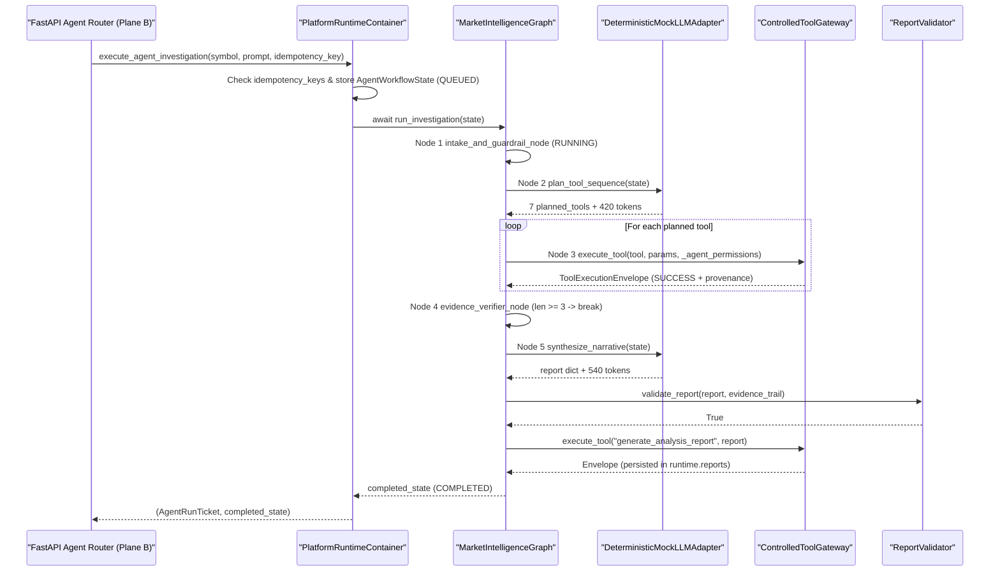

# Agent Run Sequence Diagram

| Field | Value |
|---|---|
| **Diagram ID** | `DIAG-INT-ORC-SEQ-001` |
| **Purpose** | Illustrate end-to-end runtime sequence for `UC-INT-001` (`AS-IS` inline vs `TARGET` worker). |
| **Scope & Owner** | `capability` (`CAP-INT-ORC-001`) / `ai-engineer` |
| **Authoritative Source** | [uc-int-001-execute-on-demand-investigation.md](../use-cases/uc-int-001-execute-on-demand-investigation.md) (`CAP-INT-ORC-UC-001`) |
| **Notation** | Mermaid `sequenceDiagram` (UML 2.5.1) |
| **Version & Status** | `2.0.0` / `DRAFT` (`SIMULATED`) |

**Legend**: Solid arrows (`->>`) represent `AS-IS` synchronous/awaited in-process calls.

