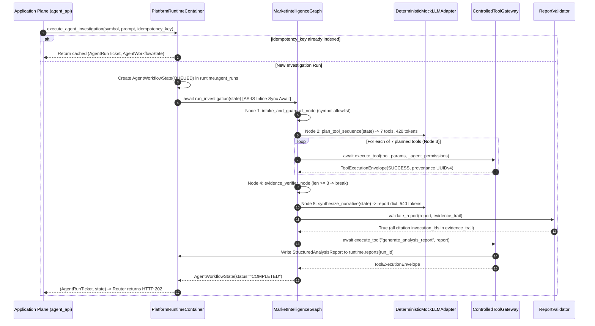

# Sequence Diagram: Agent Investigation Run (`AS-IS` Inline vs `TARGET` Worker)

## 1. Diagram Metadata

| Field | Value |
|---|---|
| **Diagram ID** | `DIAG-INT-ORC-SEQ-001` |
| **Title & Purpose** | Chronological sequence of `execute_agent_investigation()` through 5 workflow nodes, gateway tools, and validator |
| **Owner Role & Scope** | `ai-engineer / CAP-INT-ORC-001` |
| **Authoritative Source** | [uc-int-001-execute-on-demand-investigation.md](../use-cases/uc-int-001-execute-on-demand-investigation.md) (`CAP-INT-ORC-UC-001`) |
| **Notation** | `Mermaid sequenceDiagram` (`UML 2.5.1`) |
| **Version & Status** | `2.0.0 — DRAFT` |

## 2. Diagram

## 3. Legend

- **Inline Synchronous Await**: Step 4 blocks the FastAPI `POST /api/v1/agents/runs` coroutine until Node 5 completes; `TARGET` decouples queuing from `agent-worker` execution.

