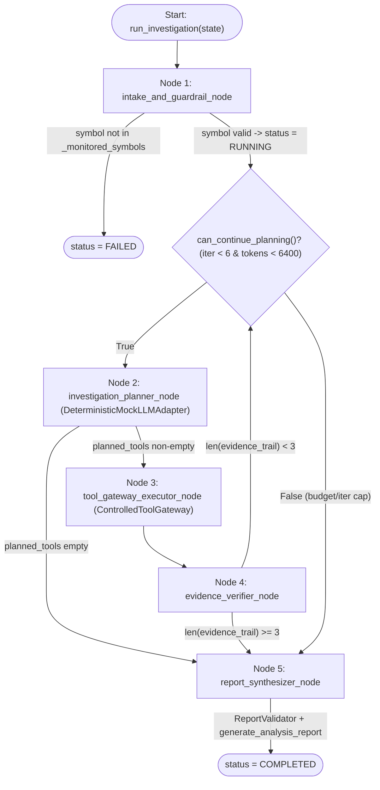

# Agent Workflow Diagram

| Field | Value |
|---|---|
| **Diagram ID** | `DIAG-INT-ORC-FLOW-001` |
| **Purpose** | Visualize the 5-node execution flow, loop bounds, and early-exit logic in `MarketIntelligenceGraph`. |
| **Scope & Owner** | `capability` (`CAP-INT-ORC-001`) / `ai-engineer` |
| **Authoritative Source** | [agent-runtime-architecture.md](../../../../../architecture/agent-runtime-architecture.md) (`INT-ARCH-RT-001`) |
| **Notation** | Mermaid `flowchart TD` (Agent Execution Graph) |
| **Version & Status** | `2.0.0` / `DRAFT` (`SIMULATED`) |

**Legend**: Solid edges (`-->`) show `AS-IS` Python control flow; diamond nodes represent conditional loop/guardrail checks.
