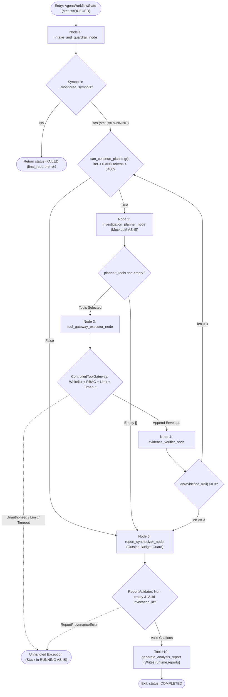

# Agent Workflow & Tool-Guard Diagram: 5-Node `MarketIntelligenceGraph`

## 1. Diagram Metadata

| Field | Value |
|---|---|
| **Diagram ID** | `DIAG-INT-ORC-AGT-001` |
| **Title & Purpose** | Execution graph for `MarketIntelligenceGraph.run_investigation()` with budget, tool-gateway, and provenance checks |
| **Owner Role & Scope** | `ai-engineer / CAP-INT-ORC-001` |
| **Authoritative Source** | [agent-specification.md](../design/agent-specification.md) (`CAP-INT-ORC-AGT-001`) |
| **Notation** | `Mermaid flowchart TD` (`Agent Execution Graph`) |
| **Version & Status** | `2.0.0 — DRAFT` |

## 2. Diagram

## 3. Legend

- **Rounded Pill (`([...])`)**: Workflow entry, terminal status (`COMPLETED`, `FAILED`), or `AS-IS` unhandled exception exit.
- **Diamond (`{...}`)**: Deterministic branch condition, loop budget guard, tool gateway firewall, or provenance check.
- **Solid vs Dashed Arrows**: Implemented control-flow transitions (`-->`) vs unhandled failure propagation paths (`-.->`).

