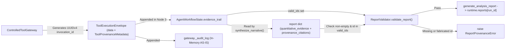

# Evidence & Provenance Flow Diagram

| Field | Value |
|---|---|
| **Diagram ID** | `DIAG-INT-ORC-PROV-001` |
| **Purpose** | Trace how `invocation_id` provenance flows from `ControlledToolGateway` through `evidence_trail` to `ReportValidator`. |
| **Scope & Owner** | `capability` (`CAP-INT-ORC-001`) / `ai-engineer` |
| **Authoritative Source** | [evaluation-and-observability.md](../../../../../architecture/evaluation-and-observability.md) (`INT-ARCH-EVAL-001`) |
| **Notation** | Mermaid `flowchart LR` (Data / Provenance Flow) |
| **Version & Status** | `2.0.0` / `DRAFT` (`PARTIALLY_IMPLEMENTED`) |

**Legend**: Solid arrows (`-->`) trace `AS-IS` provenance metadata propagation and verification.
