# Evidence & Provenance Flow Diagram

## 1. Diagram Metadata

| Field | Value |
|---|---|
| **Diagram ID** | `DIAG-INT-ORC-DFD-001` |
| **Title & Purpose** | Lineage from Data Plane stores through deterministic tools, `ToolProvenanceMetadata`, `ReportValidator`, and `StructuredAnalysisReport` |
| **Owner Role & Scope** | `ai-engineer / CAP-INT-ORC-001` |
| **Authoritative Source** | [evaluation-and-observability.md](../../../../../architecture/evaluation-and-observability.md) (`INT-ARCH-EVAL-001`) |
| **Notation** | `Mermaid flowchart LR` (`Evidence & Provenance DFD`) |
| **Version & Status** | `2.0.0 — DRAFT` |

## 2. Diagram

```mermaid
flowchart LR
    dp_stores["Data Plane Stores (In-Memory Redis/ClickHouse + Static Fallbacks AS-IS)"]
    quant["Deterministic Python Math (quant.py & anomaly_detector.py)"]
    gw["ControlledToolGateway (Attach UUIDv4 invocation_id & ToolProvenanceMetadata)"]
    trail["AgentWorkflowState.evidence_trail (ToolExecutionEnvelope List)"]
    audit["ControlledToolGateway._audit_log (Memory Only)"]
    llm["Model Adapter (Synthesize Report Dict + provenance_citations[])"]
    val{"ReportValidator (Check non-empty & invocation_id in valid_ids)"}
    err(["Raise ReportProvenanceError"])
    tool10["Tool #10: generate_analysis_report"]
    rep_store["runtime.reports[run_id] (TARGET: Postgres agent_runs.structured_report)"]

    dp_stores -->|"Raw Prices / Klines"| quant
    dp_stores -->|"Hot Quotes / Snapshots"| gw
    quant -->|"Computed Returns / Vol / Corr / Z-score"| gw
    gw -->|"Append Envelope"| trail
    gw -->|"Append Audit Copy"| audit
    trail -->|"Read Evidence Envelopes"| llm
    llm -->|"Draft Report Dict"| val
    trail -->|"Extract valid_ids Set"| val
    val -.->|"Missing or Fabricated ID"| err
    val -->|"Citation IDs Verified (Note: Text Numbers Unchecked AS-IS)"| tool10 --> rep_store
```

## 3. Legend

- **Solid Arrows (`-->`)**: Verified deterministic data and provenance flow (`AS-IS`).
- **Dashed Arrow (`-.->`)**: `ReportProvenanceError` rejection path halting ungrounded citation writes.
