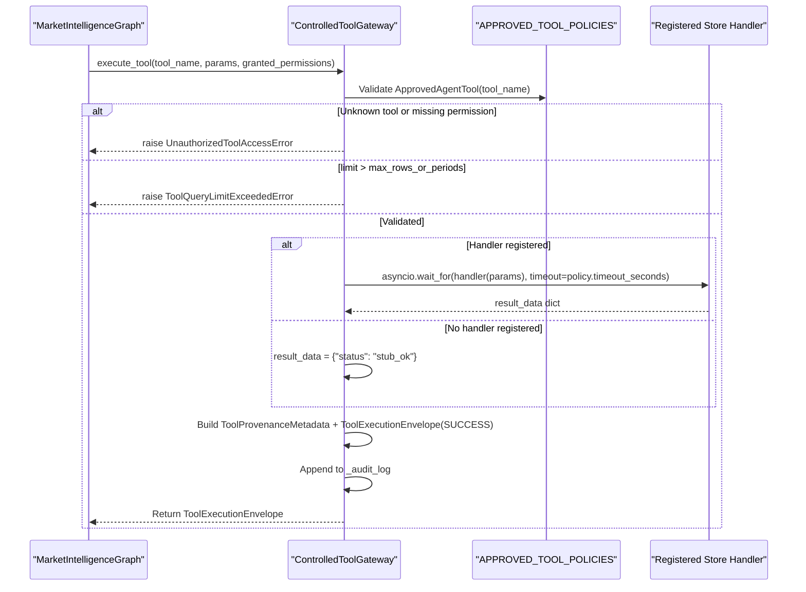

# Tool Invocation Sequence Diagram

| Field | Value |
|---|---|
| **Diagram ID** | `DIAG-INT-ORC-TOOL-SEQ-001` |
| **Purpose** | Show step-by-step validation, timeout wrapping, provenance creation, and error paths in `ControlledToolGateway`. |
| **Scope & Owner** | `capability` (`CAP-INT-ORC-001`) / `ai-engineer` |
| **Authoritative Source** | [uc-int-002-execute-approved-agent-tool.md](../use-cases/uc-int-002-execute-approved-agent-tool.md) (`CAP-INT-ORC-UC-002`) |
| **Notation** | Mermaid `sequenceDiagram` (UML 2.5.1) |
| **Version & Status** | `2.0.0` / `DRAFT` (`PARTIALLY_IMPLEMENTED`) |

**Legend**: `alt` branches depict exception paths (`UnauthorizedToolAccessError`, `ToolQueryLimitExceededError`) vs normal handler or `stub_ok` execution.

