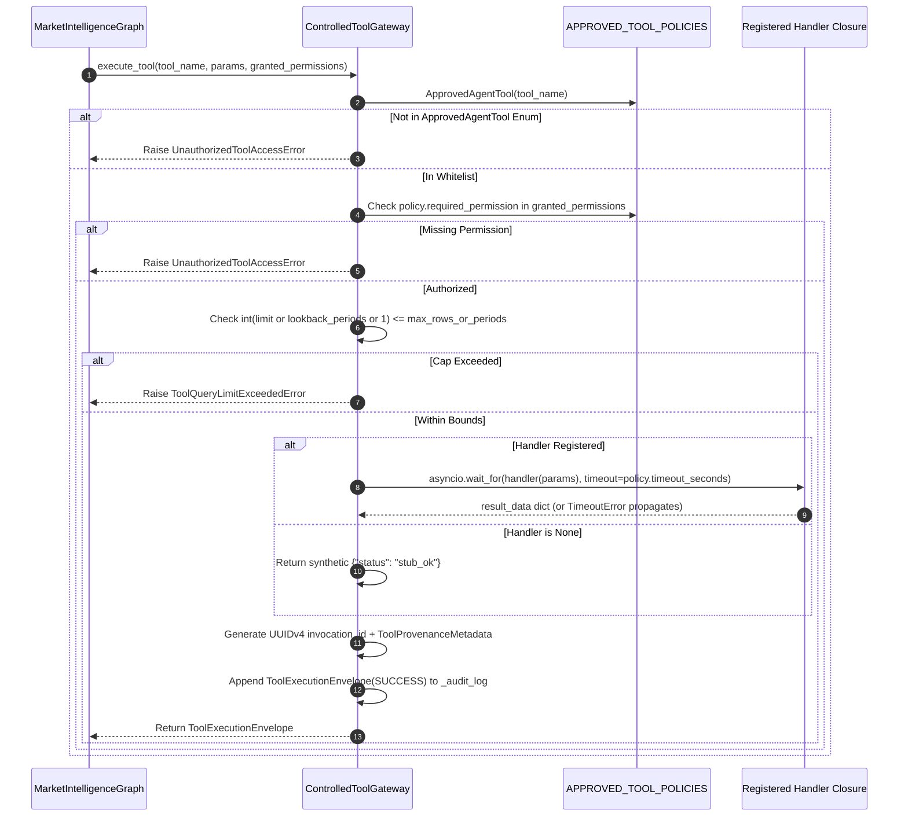

# Sequence Diagram: `ControlledToolGateway` Invocation & Provenance Wrapping

## 1. Diagram Metadata

| Field | Value |
|---|---|
| **Diagram ID** | `DIAG-INT-ORC-SEQ-002` |
| **Title & Purpose** | Chronological tool validation, timeout execution, provenance wrapping, and audit recording inside `ControlledToolGateway` |
| **Owner Role & Scope** | `ai-engineer / CAP-INT-ORC-001` |
| **Authoritative Source** | [uc-int-002-execute-approved-agent-tool.md](../use-cases/uc-int-002-execute-approved-agent-tool.md) (`CAP-INT-ORC-UC-002`) |
| **Notation** | `Mermaid sequenceDiagram` (`UML 2.5.1`) |
| **Version & Status** | `2.0.0 — DRAFT` |

## 2. Diagram

## 3. Legend

- **Exception Branches**: Errors raised prior to or during handler execution propagate directly and are NOT appended to `_audit_log` `AS-IS`.

