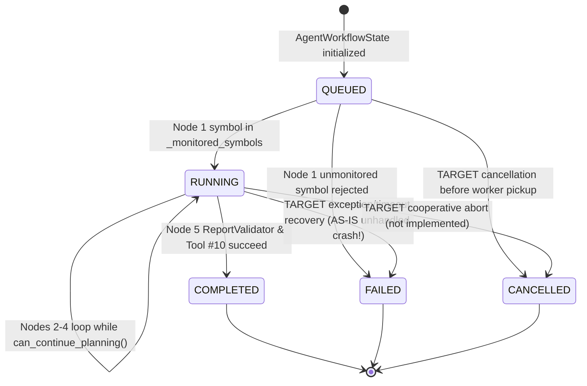

# State Diagram: `AgentWorkflowState` Lifecycle (`AS-IS` vs `TARGET`)

## 1. Diagram Metadata

| Field | Value |
|---|---|
| **Diagram ID** | `DIAG-INT-ORC-STATE-001` |
| **Title & Purpose** | Lifecycle transitions for `AgentWorkflowState.status` across `QUEUED`, `RUNNING`, `COMPLETED`, `FAILED`, and `TARGET` `CANCELLED` |
| **Owner Role & Scope** | `ai-engineer / CAP-INT-ORC-001` |
| **Authoritative Source** | [agent-runtime-architecture.md](../../../../../architecture/agent-runtime-architecture.md) (`INT-ARCH-RT-001`) |
| **Notation** | `Mermaid stateDiagram-v2` (`UML 2.5.1`) |
| **Version & Status** | `2.0.0 — DRAFT` |

## 2. Diagram

## 3. Legend

- **`QUEUED`, `RUNNING`, `COMPLETED`, `FAILED`**: Active states used in `src/intelligence/workflows/investigation.py`.
- **`RUNNING -> FAILED` & `CANCELLED`**: Defined in PostgreSQL `agent_runs` CHECK constraint (`01_schema.sql`), but `CANCELLED` and exception-caught `RUNNING -> FAILED` transitions are `NOT_IMPLEMENTED` in `MarketIntelligenceGraph` `AS-IS`.
