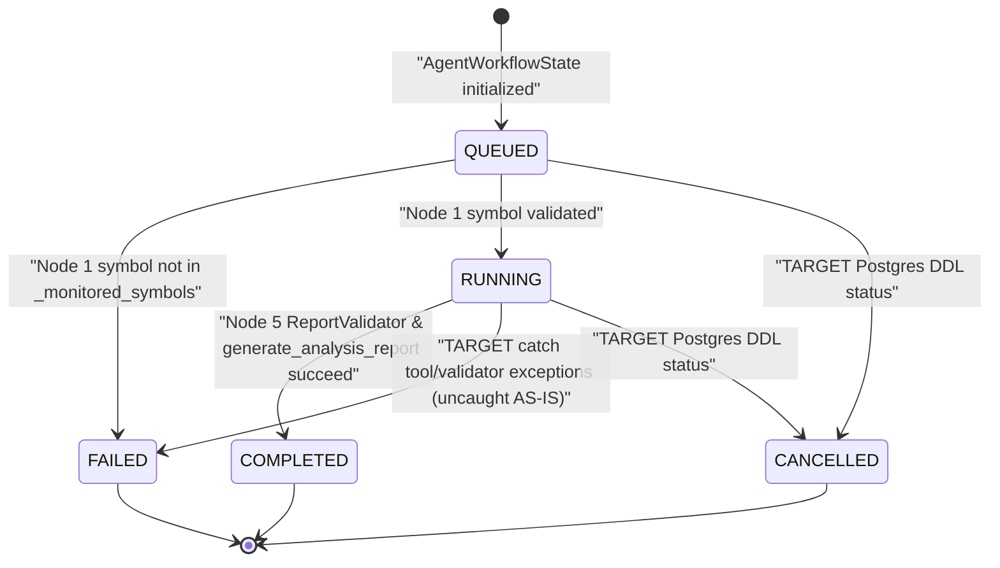

# Agent Workflow State Diagram

| Field | Value |
|---|---|
| **Diagram ID** | `DIAG-INT-ORC-STATE-001` |
| **Purpose** | Model `AgentWorkflowState.status` lifecycle transitions (`QUEUED`, `RUNNING`, `COMPLETED`, `FAILED`, `TARGET CANCELLED`). |
| **Scope & Owner** | `capability` (`CAP-INT-ORC-001`) / `ai-engineer` |
| **Authoritative Source** | [agent-runtime-architecture.md](../../../../../architecture/agent-runtime-architecture.md) (`INT-ARCH-RT-001`) |
| **Notation** | Mermaid `stateDiagram-v2` (UML 2.5.1 State Machine) |
| **Version & Status** | `2.0.0` / `DRAFT` (`SIMULATED`) |

**Legend**: `QUEUED`, `RUNNING`, `COMPLETED`, and Node 1 `FAILED` are implemented `AS-IS`; `CANCELLED` (from `01_schema.sql`) and Node 3/5 `FAILED` catch are `TARGET`.
