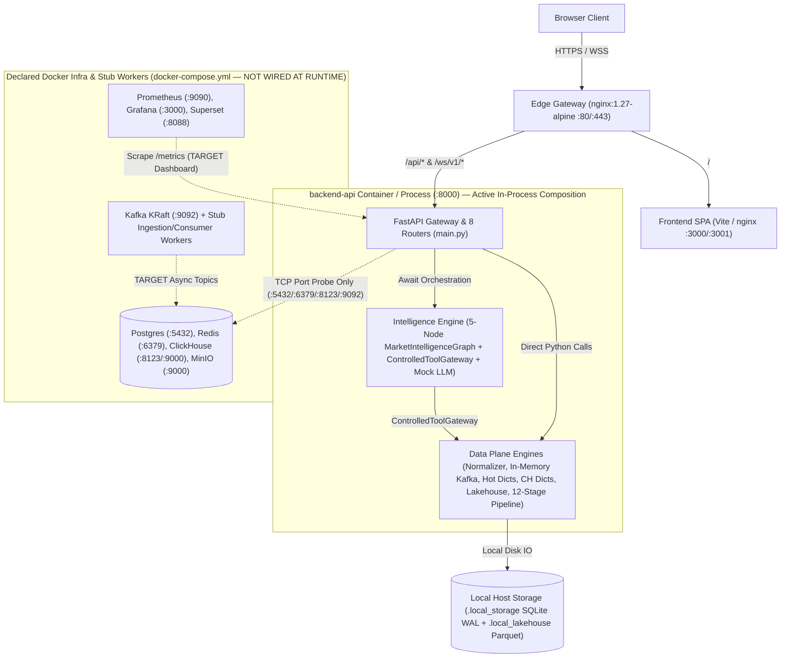

# Diagram: FMDP C4 Container Architecture

## 1. Diagram Metadata `[REQUIRED]`

| Field | Value |
|---|---|
| **Diagram ID** | `DIAG-OVR-CONT-001` |
| **Title & Purpose** | C4 Level 2 Container view of active web/API monolith, local persistence, and declared Docker containers |
| **C4 Level** | Level 2 — Container |
| **Owner Role & Scope** | `system-architect / platform` |
| **Authoritative Source** | [architecture-overview.md](../architecture/architecture-overview.md) (`OVR-ARCH-SYS-001`) |
| **Notation** | `Mermaid flowchart TB` (`C4 Model`) |
| **Version & Status** | `2.0.0 — IN_REVIEW` |

## 2. Diagram `[REQUIRED]`

## 3. Legend `[REQUIRED]`

- **Solid Arrows (`-->`)**: Verified active in-process or local-disk runtime paths on `7880c85`.
- **Dashed Arrows (`-.->`)**: Declared container infrastructure / TCP probes / stub workers not yet wired for end-to-end persistence.
