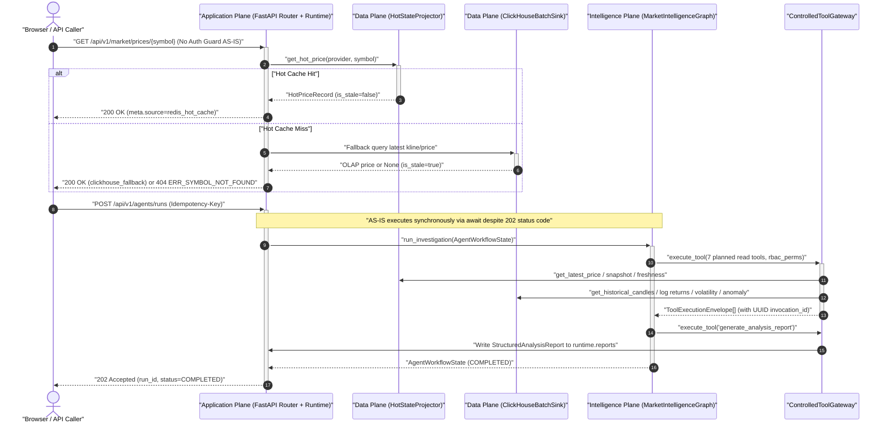

# Diagram: Cross-Plane Runtime Interaction Sequence

## 1. Diagram Metadata `[REQUIRED]`

| Field | Value |
|---|---|
| **Diagram ID** | `DIAG-OVR-XPL-001` |
| **Title & Purpose** | Chronological sequence across Application, Data, and Intelligence Planes for quote fallback and Agent runs |
| **Owner Role & Scope** | `system-architect / platform` |
| **Authoritative Source** | [cross-plane-interactions.md](../cross-plane-interactions.md) (`OVR-ARCH-XPL-001`) |
| **Notation** | `Mermaid sequenceDiagram` (`UML 2.5.1`) |
| **Version & Status** | `2.0.0 — IN_REVIEW` |

## 2. Diagram `[REQUIRED]`

## 3. Legend `[REQUIRED]`

- **Solid Arrow (`->>`)**: Synchronous HTTP or in-process Python `await` call.
- **Dashed Arrow (`-->>`)**: Return value or HTTP response.
- **`alt` / `else`**: Hot-cache hit vs. ClickHouse OLAP fallback branch.
