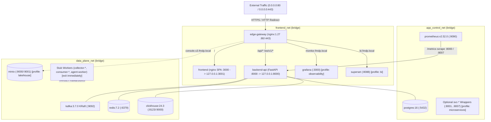

# Diagram: Compose Deployment Profiles & Network Zones

## 1. Diagram Metadata `[REQUIRED]`

| Field | Value |
|---|---|
| **Diagram ID** | `DIAG-OVR-DEP-001` |
| **Title & Purpose** | Shows `docker-compose.yml` bridge networks (`frontend_net`, `app_control_net`, `data_plane_net`), ports, and profiles |
| **Owner Role & Scope** | `devops-sre / platform` |
| **Authoritative Source** | [architecture-overview.md](../architecture/architecture-overview.md) (`OVR-ARCH-SYS-001`) |
| **Notation** | `Mermaid flowchart TB` (`Deployment Topology`) |
| **Version & Status** | `2.0.0 — IN_REVIEW` |

## 2. Diagram `[REQUIRED]`

## 3. Legend `[REQUIRED]`

- **Subgraph**: Docker bridge networks configured in `docker-compose.yml:565-571`.
- **Undirected Link (`---`)**: Declared Compose network/dependency connectivity (currently TCP-probed only by `backend-api`; workers exit cleanly without event loops).
- **Dashed Arrow (`-.->`)**: Optional profile services (`lakehouse`) or unimplemented worker paths.
