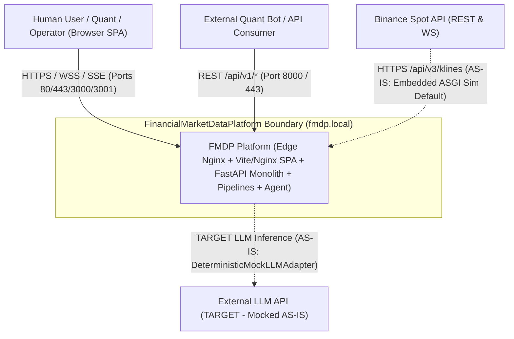

# Diagram: FMDP System Context (C4 Level 1)

## 1. Diagram Metadata `[REQUIRED]`

| Field | Value |
|---|---|
| **Diagram ID** | `DIAG-OVR-CTX-001` |
| **Title & Purpose** | C4 Level 1 System Context showing FMDP boundary, human actors, API clients, and upstream/infrastructure systems |
| **C4 Level** | Level 1 — System Context |
| **Owner Role & Scope** | `system-architect / platform` |
| **Authoritative Source** | [system-context.md](../system-context.md) (`OVR-CTX-001`) |
| **Notation** | `Mermaid flowchart TB` (`C4 Model`) |
| **Version & Status** | `2.0.0 — IN_REVIEW` |

## 2. Diagram `[REQUIRED]`

## 3. Legend `[REQUIRED]`

- **Solid Arrow (`-->`)**: Active implemented HTTP/SSE/WS interface exposed by the running platform.
- **Dashed Arrow (`-.->`)**: External dependency that runs via in-process simulation (`AS-IS`) or remains `NOT_IMPLEMENTED` (`TARGET`).
- **Subgraph**: Complete FMDP runtime and declared infrastructure boundary (`docker-compose.yml`).
