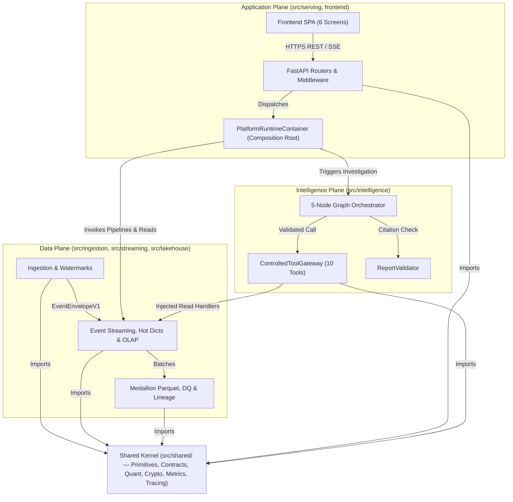

# Diagram: Three-Plane Ownership & Allowed Dependencies

## 1. Diagram Metadata `[REQUIRED]`

| Field | Value |
|---|---|
| **Diagram ID** | `DIAG-OVR-3P-001` |
| **Title & Purpose** | Shows package ownership and AST-enforced dependency rules across Shared Kernel and Three Planes |
| **Owner Role & Scope** | `system-architect / platform` |
| **Authoritative Source** | [three-plane-architecture.md](../three-plane-architecture.md) (`OVR-ARCH-3P-001`) |
| **Notation** | `Mermaid flowchart TB` |
| **Version & Status** | `2.0.0 — IN_REVIEW` |

## 2. Diagram `[REQUIRED]`

## 3. Legend `[REQUIRED]`

- **Subgraphs**: Logical ownership Planes matching `docs/docs-index.yaml` and `tests/architecture/test_clean_architecture_boundaries.py`.
- **Prohibited Edges (Enforced by AST)**: Neither Data Plane nor Intelligence Plane imports `src/serving/`; `*/domain/*.py` never imports web or DB drivers.
